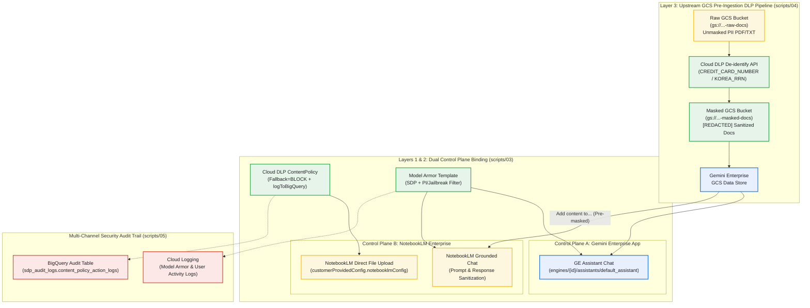

# Gemini Enterprise & NotebookLM 민감정보 보호(`SDP` · `Model Armor`) 통합 `Governance` `Demo`

> **End-to-End Sensitive Data Protection (`SDP Content Policy` + `Model Armor` + `Upstream GCS De-identification`) Governance Demo for `Gemini Enterprise` & `NotebookLM Enterprise`**

본 `Repository`는 `Google Cloud` 환경에서 **`Gemini Enterprise (GE)` `Assistant Chat`**과 **`NotebookLM Enterprise`**를 함께 운영할 때 발생하는 민감정보 보호(`SDP`) 적용 범위 차이를 진단하고, **3계층 보안 통제(`3-Layer Security Defense`)** 및 **`BigQuery`·`Cloud Logging` 감사 증적(`Audit Trail`)**을 원클릭으로 구성·검증하기 위한 실전 `Demo` 패키지입니다.

---

## 1. 배경 및 핵심 아키텍처 차이 (`Why NotebookLM Needs Dedicated SDP Governance`)

고객 환경에서 `Cloud Storage (GCS)` `Data Store`를 연결하여 사용할 때, **`GE Assistant Chat`에서는 민감정보(`CREDIT_CARD_NUMBER`, `KOREA_RRN` 등)가 정상적으로 마스킹/차단되지만 `NotebookLM Enterprise`에서는 `GCS` 문서를 가져오거나(`"Add content to..."`) 로컬 파일을 `Upload`할 때 `SDP`가 동작하지 않는 현상**은 다음 세 가지 구조적 원인에서 비롯됩니다.

1. **`Control Plane` 분리 (`Engine-Level` vs. `Project-Level`)**:
   - `GE Assistant Chat`은 개별 `Engine` (`engines/{ENGINE_ID}/assistants/default_assistant`) 및 `Data Connector`에 설정된 `Model Armor` / `SDP Content Policy`를 참조합니다.
   - 반면 `NotebookLM Enterprise`는 개별 `GE App` 하위 리소스가 아닌 **`Project` + `Location` (`global` 또는 `us`) 수준의 독립 `Control Plane` (`customerProvidedConfig.notebooklmConfig`)** 설정을 참조하므로, `GE App`에 적용한 정책이 자동 상속되지 않습니다.
2. **`NotebookLM` 내 `GCS` 문서 가져오기(`"Add content to..."`) 경로의 특성**:
   - 로컬 PC에서 파일을 직접 `Upload`할 때는 `NotebookLM`에 바인딩된 `SDP Content Policy`가 동기식(`Synchronous`)으로 파일을 스캔하여 차단(`BLOCK`)합니다.
   - 그러나 이미 색인된 `GE GCS Data Store` 문서를 `"Add content to..."` 메뉴로 가져올 때는 내부 `Data Store` 간 문서 복사로 처리되어 업로드용 `SDP Hook`을 거치지 않습니다. 따라서 `GCS Data Store`에는 반드시 **사전 비식별화(`Upstream Cloud DLP De-identification`)된 `Masked Bucket`만 연결**해야 합니다.
3. **`Luhn Checksum` 검증, `Fallback Action` 기본값, 그리고 `10분 Cache TTL`**:
   - `Cloud DLP`의 `CREDIT_CARD_NUMBER` `InfoType`은 단순 16자리 숫자가 아니라 **`Luhn Checksum` 알고리즘을 통과하는 유효 카드번호**만 탐지합니다.
   - 대용량 파일이 스캔 한도를 초과할 때 기본값(`FALLBACK_ACTION_INPUT_TOO_LARGE = ALLOW`)이 유지되면 우회가 발생하므로 반드시 **`BLOCK`**으로 설정해야 합니다.
   - `NotebookLM` 서버는 `customerProvidedConfig`를 최대 **10분간 인메모리 캐싱(`CustomerConfigurationCache`)**하므로 정책 변경 후 반영 주기를 고려해야 합니다.



---

## 2. `Repository` 디렉토리 구조 (`Repository Structure`)

```text
ge-notebooklm-sdp-governance-demo/
├── README.md                          # 전체 아키텍처 개요 및 Quickstart Guide
├── Makefile                           # 단계별 Live Demo 실행 명령어 (prepare, inspect, apply, mask, verify, reset)
├── pyproject.toml                     # Python 의존성 정의 (uv / pip 호환)
├── .env.example                       # 환경변수 설정 템플릿
├── docs/
│   ├── CONSOLE_UI_CONFIGURATION_GUIDE_KR.md # [신규] 스크립트 없이 Google Cloud Console UI 메뉴만으로 구성하는 단계별 가이드
│   ├── DEMO_RUNBOOK_KR.md             # 고객 대면 Live Demo 시연 시나리오 및 단계별 발표 가이드
│   └── ARCHITECTURE_DEEP_DIVE.md      # Control Plane 분리 구조 및 감사 Logging 상세 기술 명세
├── sample_data/
│   ├── vip_customer_claim_raw.txt     # 유효한 Luhn Checksum 카드번호 및 주민등록번호가 포함된 테스트 문서
│   └── store_operation_policy_clean.txt # 민감정보가 없는 일반 사내 규정 문서 (Positive Control)
├── scripts/
│   ├── common.py                      # 공통 환경변수 로더, ADC 인증, Luhn Checksum 검증기
│   ├── 01_prepare_demo_assets.py      # [Step 1] Raw/Masked GCS Bucket, BigQuery Table 및 샘플 PDF/TXT 생성
│   ├── 02_inspect_current_config.py   # [Step 2] GE App vs. NotebookLM Control Plane 설정 비교 진단
│   ├── 03_apply_sdp_and_armor.py      # [Step 3] DLP ContentPolicy & Model Armor 생성 및 양쪽 Control Plane 바인딩
│   ├── 04_run_gcs_dlp_masking.py      # [Step 4] Raw GCS -> Cloud DLP 마스킹 -> Masked GCS 업로드 및 Data Store 동기화
│   ├── 05_verify_enforcement_logs.py  # [Step 5] Model Armor 런타임 테스트 및 BigQuery / Cloud Logging 감사 조회
│   └── 06_reset_demo_policies.py      # [Reset] 반복 시연을 위한 NotebookLM 정책 바인딩 초기화
└── terraform/                         # (선택사항) 신규 GCP Sandbox Project 초기 인프라(API, IAM, GCS, BQ) 프로비저닝
    ├── versions.tf
    ├── variables.tf
    ├── apis.tf
    ├── iam.tf
    ├── storage_bigquery.tf
    ├── outputs.tf
    └── terraform.tfvars.example
```

---

## 3. 빠른 시작 가이드 (`Quickstart Guide`)

### 3.1 사전 요구사항 (`Prerequisites`)
- `Google Cloud SDK` (`gcloud`) 설치 및 인증 완료:
  ```bash
  gcloud auth login
  gcloud auth application-default login
  ```
- `Python 3.10+` 및 [`uv`](https://docs.astral.sh/uv/) (또는 표준 `venv`/`pip`) 설치
- 대상 `Google Cloud Project`에서 `Discovery Engine`, `Cloud DLP`, `Model Armor`, `Cloud Storage`, `BigQuery` 권한 보유 *(신규 빈 `Project`인 경우 `cd terraform && terraform apply`로 필수 `API` 및 `Service Agent IAM Role`을 자동 구성할 수 있습니다.)*

### 3.2 설치 및 환경변수 구성
```bash
# 1. Repository 클론 및 디렉토리 이동
git clone https://github.com/rhkim77/ge-notebooklm-sdp-governance-demo.git
cd ge-notebooklm-sdp-governance-demo

# 2. 의존성 패키지 설치 (uv 사용 시 자동 가상환경 구성)
make install

# 3. 환경변수 파일(.env) 생성 및 PROJECT_ID, LOCATION(global 또는 us), GE_ENGINE_ID 입력
cp .env.example .env
vi .env
```

### 3.3 5단계 `Live Demo` 실행 (`Step-by-Step Execution`)

| 순서 | 실행 명령어 (`Make Target`) | 실행 스크립트 (`Script`) | 주요 수행 작업 및 시연 포인트 |
| :---: | :--- | :--- | :--- |
| **Step 1** | `make prepare-assets` | `scripts/01_prepare_demo_assets.py` | 샘플 카드번호의 `Luhn Checksum` 유효성 검증, 테스트용 `PDF`/`TXT` 2종 생성, `Raw`/`Masked` `GCS Bucket` 및 `BigQuery` 감사 `Table` (`content_policy_action_logs`) 생성 |
| **Step 2** | `make inspect` | `scripts/02_inspect_current_config.py` | **(`Before` 진단)** `GE App` (`engines/{id}`)과 `Project` 수준 `NotebookLM` (`customerProvidedConfig.notebooklmConfig`)의 `SDP`·`Model Armor` 바인딩 상태를 나란히 비교 출력 |
| **Step 3** | `make apply-policy` | `scripts/03_apply_sdp_and_armor.py` | **(`Layer 1 & 2` 조치)** `Cloud DLP ContentPolicy` (`Fallback=BLOCK` + `BigQuery` 로깅) 및 `Model Armor Template` (`SDP Filter`)을 생성하고 `NotebookLM`과 `GE App` 양쪽에 바인딩 |
| **Step 4** | `make mask-gcs` | `scripts/04_run_gcs_dlp_masking.py` | **(`Layer 3` 조치)** `Raw GCS Bucket`의 문서를 `Cloud DLP API`로 비식별화하여 `Masked GCS Bucket`에 업로드(터미널에 `Before vs. After` 비교 출력) 및 `GE Data Store` 재동기화 |
| **Step 5** | `make verify-logs` | `scripts/05_verify_enforcement_logs.py` | **(`After` 검증)** `Model Armor` `sanitizeUserPrompt` 실시간 호출 검증, `ContentPolicy.errors` 헬스체크, `BigQuery` `ContentPolicyActionLog` 및 `Cloud Logging` 감사 레코드 출력 |
| **Reset** | `make reset-policy` | `scripts/06_reset_demo_policies.py` | 반복 시연을 위해 `NotebookLM` `Project` 수준 정책 바인딩을 초기(`Unbound`) 상태로 원복 |

---

## 4. 핵심 문서 안내 (`Documentation Links`)

- **[`docs/CONSOLE_UI_CONFIGURATION_GUIDE_KR.md`](docs/CONSOLE_UI_CONFIGURATION_GUIDE_KR.md)**: **(권장 — `No-Script` 메뉴 가이드)** 스크립트 실행 없이 **`Google Cloud Console` 웹 메뉴(`IAM`, `BigQuery`, `Sensitive Data Protection`, `Model Armor`, `Gemini Enterprise`)에서 클릭으로 구성하는 단계별 매뉴얼**.
- **[`docs/DEMO_RUNBOOK_KR.md`](docs/DEMO_RUNBOOK_KR.md)**: 고객 대면 시연 시 발표자가 그대로 따라 읽으며 시연할 수 있는 **15분 `Live Demo Runbook`** (`Before` 노출 재현 $\rightarrow$ 3계층 보안 적용 $\rightarrow$ `After` 차단 및 `BigQuery` 감사 로그 확인).
- **[`docs/ARCHITECTURE_DEEP_DIVE.md`](docs/ARCHITECTURE_DEEP_DIVE.md)**: `GE` vs. `NotebookLM` `Control Plane` 아키텍처, `Multi-Region` (`global` vs `us`) 일치 규칙, `Service Agent IAM Role` 명세, 그리고 4대 감사 로깅 채널 상세 분석.
