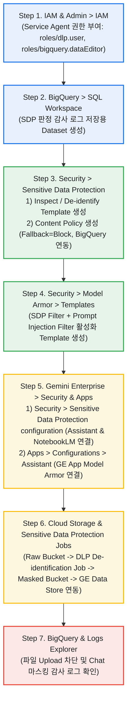

# Google Cloud Console UI 메뉴 기반 단계별 구성 Guide (`No-Script / Console UI Walkthrough`)

본 문서는 별도의 `Python Script`나 로컬 개발 환경 설치 없이, **순수하게 `Google Cloud Console` 웹 메뉴(`UI`)를 클릭하여 `Gemini Enterprise (GE)` 및 `NotebookLM Enterprise`의 3계층 민감정보 보호(`SDP Content Policy` + `Model Armor` + `GCS` 사전 마스킹) 및 `BigQuery` 감사 로깅을 처음부터 끝까지 구성하는 단계별 매뉴얼**입니다.

---

## 한눈에 보는 `Google Cloud Console` 메뉴 구성 흐름도



> **[!IMPORTANT] `Console UI` 지원 범위 안내**
> - 아래 **전체 구성의 95% 이상**(`IAM`, `BigQuery`, `SDP Template`, `SDP Content Policy`, `GCS DLP De-identification Job`, `Model Armor Template`, `GE App Assistant 설정`, `NotebookLM Upload SDP 연결`)은 **`Google Cloud Console` 웹 메뉴만으로 100% 설정 가능**합니다.
> - 단, **`NotebookLM Enterprise`의 대화창(`Chat`)에 `Model Armor Template`을 바인딩하는 항목(`notebooklmConfig.modelArmorConfig`)**만 현재 `Google Cloud` 사양상 `Console UI` 메뉴가 제공되지 않으므로, `Step 5.3`에 안내된 것처럼 브라우저 우측 상단의 **`Cloud Shell` 아이콘(`>_`)을 눌러 명령어 1회만 붙여넣기**하면 모든 구성이 완결됩니다. **`[확인됨 / Verified: Screen prompts and responses using Model Armor in Gemini Notebook Enterprise]`**

---

## Step 1. `IAM & Admin` 메뉴에서 필수 `Service Agent` 권한 부여

`Gemini Enterprise`/`NotebookLM`이 `Sensitive Data Protection (SDP)` 정책을 실행하고, `SDP`가 판정 결과를 `BigQuery`에 기록할 수 있도록 2개의 기본 `Service Agent`에 권한을 부여합니다.

1. `Google Cloud Console` 좌측 탐색 메뉴(`☰`)에서 **`IAM & Admin` > `IAM`**으로 이동합니다.
2. 화면 우측 상단의 **`Include Google-provided role grants` (Google에서 제공하는 역할 부여 포함)** 체크박스를 **반드시 체크**합니다.
3. **1) `Discovery Engine Service Agent` 권한 추가**:
   - 목록에서 `service-{PROJECT_NUMBER}@gcp-sa-discoveryengine.iam.gserviceaccount.com` 계정을 찾아 우측 연필 아이콘(**`Edit principal`**)을 클릭합니다.
   - **`+ ADD ANOTHER ROLE`**을 클릭하고 **`DLP User`** (`roles/dlp.user`)를 검색하여 선택한 뒤 **`SAVE`**를 클릭합니다.
4. **2) `Cloud Data Loss Prevention Service Agent` 권한 추가 (`BigQuery` 로깅용)**:
   - 목록에서 `service-{PROJECT_NUMBER}@dlp-api.iam.gserviceaccount.com` 계정을 찾아 우측 연필 아이콘(**`Edit principal`**)을 클릭합니다.
   - **`+ ADD ANOTHER ROLE`**을 클릭하고 **`BigQuery Data Editor`** (`roles/bigquery.dataEditor`)를 선택한 뒤 **`SAVE`**를 클릭합니다.

---

## Step 2. `BigQuery` 메뉴에서 `SDP` 감사 로그용 `Dataset` 준비

`SDP Content Policy`가 파일을 스캔할 때마다 차단(`BLOCK`)/허용(`ALLOW`) 판정 이력을 자동 적재할 `BigQuery Dataset`을 생성합니다.

1. 좌측 메뉴(`☰`)에서 **`BigQuery` > `Studio` (`SQL Workspace`)**로 이동합니다.
2. `Explorer` 패널에서 현재 `Project ID` 우측의 점 3개(`⋮`) 아이콘을 클릭하고 **`Create dataset`**을 선택합니다.
3. 다음 항목을 입력하고 **`CREATE DATASET`**을 클릭합니다:
   - **`Dataset ID`**: `sdp_audit_logs`
   - **`Location type`**: **`Multi-region`** 선택 후 **`US (multiple regions in United States)`** 지정 *(참고: `SDP Content Policy`가 자동으로 하위 `Table`을 생성하거나 지정한 `Table`에 스트리밍 적재합니다.)*

---

## Step 3. `Security > Sensitive Data Protection` 메뉴에서 `Template` 및 `Content Policy` 생성

### 3.1 `Inspection Template` 및 `De-identification Template` 생성 (`Model Armor` 및 `GCS` 마스킹 연동용)
1. 좌측 메뉴(`☰`)에서 **`Security` > `Sensitive Data Protection`**으로 이동합니다.
2. 상단 탭에서 **`CONFIGURATION` > `Templates`** 탭을 클릭한 뒤 **`+ CREATE TEMPLATE`**을 클릭합니다.
3. **1) `Inspect Template` 생성**:
   - **`Template type`**: `Inspect` 선택
   - **`Template ID`**: `ge-notebooklm-inspect-tmpl`
   - **`Location type`**: **`Multi-region`** 또는 **`Global`** 중 보호 대상 `Gemini Enterprise`/`NotebookLM`의 `Location` (`global` 또는 `us`)과 **동일한 위치** 선택
   - **`Configure detection` (`InfoTypes`)**: **`MANAGE INFOTYPES`**를 클릭하여 다음 항목을 체크합니다:
     - `CREDIT_CARD_NUMBER` (신용카드 번호 — `Luhn Checksum` 검증 기반)
     - `KOREA_RRN` (대한민국 주민등록번호)
     - `PHONE_NUMBER` (전화번호)
   - **`Minimum likelihood`**: `Possible` 선택 후 **`CREATE`**를 클릭합니다.
4. **2) `De-identification Template` 생성**:
   - 다시 **`+ CREATE TEMPLATE`**을 클릭하고 **`Template type`**에서 `De-identify`를 선택합니다.
   - **`Template ID`**: `ge-notebooklm-deid-tmpl`, **`Location`**: 위와 동일하게(`global` 또는 `us`) 설정합니다.
   - **`Transformation`** 방식에서 **`InfoType` transformation**을 선택하고, 규칙(`Rule`)으로 **`Replace with InfoType name`** (예: 카드번호를 `[CREDIT_CARD_NUMBER]`로 치환) 또는 **`Mask with character`** (`*` 마스킹)를 선택한 뒤 **`CREATE`**를 클릭합니다.

### 3.2 `Content Policy` 생성 (`File Upload` 및 `Data Connector` 스캔용)
1. `Sensitive Data Protection` 화면 상단에서 **`CONFIGURATION` > `Content policies`** 탭을 클릭하고 **`+ CREATE POLICY`**를 클릭합니다.
2. **Step 1 (`Name policy`)**:
   - **`Policy ID`**: `ge-notebooklm-sdp-policy`
   - **`Region` (`Location`)**: 대상 `Gemini Enterprise` 및 `NotebookLM`이 위치한 **`global` 또는 `us`** 선택 *(중요: 반드시 실제 사용하는 `NotebookLM`의 `Location`과 일치해야 합니다!)*
3. **Step 2 (`Add rules`)**:
   - **`+ ADD RULE`**을 클릭합니다.
   - **`InfoTypes`**에서 `CREDIT_CARD_NUMBER`, `KOREA_RRN` 등을 선택하고 **`Minimum likelihood`**를 `Possible` (또는 `Likely`)로 설정합니다.
   - **`Action`**에서 **`Block`** (차단)을 선택합니다.
4. **Step 3 (`Specify fallback actions` — 대용량 파일 우회 방지 핵심 설정)**:
   - 기본값이 `Allow`로 되어 있는 예외 처리 항목을 다음과 같이 변경합니다:
     - **`Input exceeds the size limit` (`FALLBACK_ACTION_INPUT_TOO_LARGE`)**: **`Block`** 선택
     - **`Sensitive Data Protection error`**: **`Block`** 선택
     - **`Unsupported file type`**: 보안 정책에 따라 `Allow` 또는 `Block` 선택
5. **Step 4 (`Add logging`)**:
   - **`Log to BigQuery`** 토글을 활성화합니다.
   - **`Project ID`**, **`Dataset ID`** (`sdp_audit_logs`), **`Table ID`** (`content_policy_action_logs`)를 입력하고 **`CREATE`**를 클릭합니다.

---

## Step 4. `Security > Model Armor` 메뉴에서 `Template` 생성

`GE Assistant Chat`과 `NotebookLM Chat`에서 질문(`Prompt`), `GCS` 검색 문맥(`Grounded Context`), 답변(`Response`) 내 민감정보를 실시간 마스킹/차단할 `Model Armor Template`을 생성합니다.

1. 좌측 메뉴(`☰`)에서 **`Security` > `Model Armor`** (또는 상단 검색창에서 `Model Armor` 검색)로 이동합니다.
2. **`+ CREATE TEMPLATE`**을 클릭합니다.
3. 기본 정보를 입력합니다:
   - **`Template ID`**: `ge-notebooklm-armor-tmpl`
   - **`Region` (`Location`)**: `GE App` 및 `NotebookLM`과 동일한 `Location` (`global` 또는 `us`) 선택
4. **`Filters` 구성**:
   - **`Prompt injection and jailbreak detection`**: 체크 활성화 (`Confidence level`: `Medium and above`)
   - **`Sensitive Data Protection (SDP)`**: 체크 활성화
     - **`Configuration mode`**: **`Advanced`** 선택
     - **`Inspect template`**: `Step 3.1`에서 생성한 `projects/{PROJECT_ID}/locations/{LOCATION}/inspectTemplates/ge-notebooklm-inspect-tmpl` 입력
     - **`De-identify template`**: `Step 3.1`에서 생성한 `projects/{PROJECT_ID}/locations/{LOCATION}/deidentifyTemplates/ge-notebooklm-deid-tmpl` 입력
5. **`Logging` 구성**:
   - 하단의 **`Log sanitize operations` (살균/검열 작업 로깅)** 체크박스를 활성화하고 **`CREATE`**를 클릭합니다.

---

## Step 5. `Gemini Enterprise` 메뉴에서 `GE App` 및 `NotebookLM`에 정책 연결

이제 생성한 `SDP Content Policy`와 `Model Armor Template`을 **`GE App`**과 **`NotebookLM Enterprise`** 양쪽 제어 계층에 각각 연결합니다.

| 설정 메뉴 위치 (`Console Navigation Path`) | 적용 대상 서비스 | 연결할 보안 리소스 | `Console UI` 지원 여부 |
| :--- | :--- | :--- | :---: |
| **`Gemini Enterprise` > `Security` > `Sensitive Data Protection configuration`** | 1) `GE Assistant` 첨부파일<br/>2) **`NotebookLM` 직접 `Upload` 파일** | `Step 3.2`의 `SDP Content Policy`<br/>(`ge-notebooklm-sdp-policy`) | **100% `UI` 지원** |
| **`Gemini Enterprise` > `Apps` > `[대상 App]` > `Configurations` > `Assistant`** | `GE Assistant Chat` (`Prompt`, `GCS` 검색 문맥, `Response`) | `Step 4`의 `Model Armor Template`<br/>(`ge-notebooklm-armor-tmpl`) | **100% `UI` 지원** |
| **`Console` 우측 상단 `Cloud Shell` (`>_`) 1회 실행** | **`NotebookLM Chat`** (`Prompt` & `Response`) | `Step 3.2` `SDP Policy` + `Step 4` `Model Armor Template` | `Cloud Shell` 1줄 실행 |

### 5.1 `Console UI`에서 `Assistant` 및 `NotebookLM` 업로드용 `SDP Content Policy` 연결
1. 좌측 메뉴(`☰`)에서 **`Gemini Enterprise` (또는 `AI Applications` / `Agentspace`) > `Security`** 메뉴로 이동합니다.
2. **`Sensitive Data Protection configuration`** 탭을 선택합니다.
3. 상단 **`Region`** 드롭다운에서 사용 중인 `Location` (**`global`** 또는 **`us`**)을 선택합니다. *(참고: 만약 고객사에서 `global`과 `us`를 모두 사용 중이라면 두 `Region` 각각에서 수행합니다.)*
4. **1) `Assistant setting` 섹션**:
   - **`Edit`**를 클릭하고 `Step 3.2`에서 생성한 `ge-notebooklm-sdp-policy`를 선택하여 저장합니다.
5. **2) `NotebookLM setting` 섹션 (핵심!)**:
   - 하단 `NotebookLM setting`의 **`Edit`**를 클릭합니다.
   - **`Enable Sensitive Data Protection for uploads`** 체크박스를 **반드시 체크**합니다.
   - 드롭다운에서 `ge-notebooklm-sdp-policy`를 선택하고 **`Save`**를 클릭합니다.

### 5.2 `Console UI`에서 `GE App`에 `Model Armor Template` 연결
1. **`Gemini Enterprise` > `Apps`**로 이동하여 사용 중인 `GE App`을 클릭합니다.
2. 좌측 하위 메뉴에서 **`Configurations` > `Assistant`** 탭으로 이동합니다.
3. **`Model Armor`** 설정 영역에서 **`Edit`**를 클릭합니다.
4. **`Prompt template`** 및 **`Response template`** 드롭다운에서 `Step 4`에서 생성한 `ge-notebooklm-armor-tmpl`을 선택하고 **`Save`**를 클릭합니다.

### 5.3 `NotebookLM Chat`에 `Model Armor Template` 추가 바인딩 (`Console` 내 `Cloud Shell` 1회 실행)
`NotebookLM Enterprise`의 대화창(`Chat`)에서도 `Model Armor`가 동작하도록 하려면, `Google Cloud Console` 우측 상단의 **`Activate Cloud Shell` (`>_`)** 버튼을 클릭하고 아래 명령어를 복사해 붙여넣습니다:

```bash
export PROJECT_ID=$(gcloud config get-value project)
export PROJECT_NUMBER=$(gcloud projects describe ${PROJECT_ID} --format="value(projectNumber)")
# 사용 중인 Location에 맞게 global 또는 us 지정 (global인 경우 API_ENDPOINT="https://discoveryengine.googleapis.com")
export LOCATION="global"
export API_ENDPOINT="https://discoveryengine.googleapis.com"

curl -X PATCH \
  -H "Authorization: Bearer $(gcloud auth print-access-token)" \
  -H "Content-Type: application/json" \
  -H "X-Goog-User-Project: ${PROJECT_ID}" \
  "${API_ENDPOINT}/v1alpha/projects/${PROJECT_NUMBER}?update_mask=customerProvidedConfig" \
  -d "{
    \"customerProvidedConfig\": {
      \"notebooklmConfig\": {
        \"dataProtectionPolicy\": {
          \"sensitiveDataProtectionPolicy\": {
            \"policy\": \"projects/${PROJECT_ID}/locations/${LOCATION}/contentPolicies/ge-notebooklm-sdp-policy\"
          }
        },
        \"modelArmorConfig\": {
          \"userPromptTemplate\": \"projects/${PROJECT_ID}/locations/${LOCATION}/templates/ge-notebooklm-armor-tmpl\",
          \"responseTemplate\": \"projects/${PROJECT_ID}/locations/${LOCATION}/templates/ge-notebooklm-armor-tmpl\",
          \"failureMode\": \"FAIL_CLOSED\"
        }
      }
    }
  }"
```

> **[!NOTE] 설정 반영 대기 시간 (최대 10분)**
> `NotebookLM Enterprise`에 정책을 연결한 직후에는 백엔드 설정 캐시(`CustomerConfigurationCache`)가 갱신되기까지 **최대 10분**이 소요될 수 있습니다. 아래 `Step 6`을 구성한 뒤 테스트를 진행하면 자연스럽게 캐시 갱신 시간이 경과합니다.

---

## Step 6. `Cloud Storage` 및 `Sensitive Data Protection Job` 메뉴로 `GCS` 사전 마스킹 구성

`NotebookLM`에서 `"Add content to..."`로 `GCS Data Store` 문서를 가져올 때 민감정보가 노출되지 않도록, `Console UI`의 **무코드(`No-Code`) `DLP De-identification Job`**을 사용하여 마스킹된 버킷을 구성합니다.

1. **`Cloud Storage` > `Buckets`**로 이동하여 두 개의 `Bucket`을 생성합니다:
   - 원본 스테이징 버킷 (`Raw Bucket`): `<PROJECT_ID>-ge-sdp-raw-docs` (여기에 샘플 파일인 `sample_data/vip_customer_claim_raw.txt` 및 `store_operation_policy_clean.txt` 업로드)
   - 마스킹 완료 버킷 (`Masked Bucket`): `<PROJECT_ID>-ge-sdp-masked-docs` (`GE Data Store`에 실제로 연결할 버킷)
2. **`Security` > `Sensitive Data Protection`**으로 이동하여 상단 **`INSPECTION` > `Jobs and job triggers`** 탭을 클릭하고 **`+ CREATE JOB OR TRIGGER`**를 선택합니다.
3. **`Choose input data`**:
   - **`Storage type`**: `Cloud Storage` 선택
   - **`Include URL`**: `gs://<PROJECT_ID>-ge-sdp-raw-docs/` 지정
4. **`Configure detection`**:
   - **`Inspection template`**: `Step 3.1`에서 만든 `ge-notebooklm-inspect-tmpl` 선택
5. **`Add actions` (`Make a de-identified copy` 활성화)**:
   - **`Make a de-identified copy`** (비식별화된 사본 만들기) 토글을 **ON**으로 켭니다.
   - **`Cloud Storage output bucket`**: `gs://<PROJECT_ID>-ge-sdp-masked-docs` 입력
   - **`Default transformation template`**: `Step 3.1`에서 만든 `ge-notebooklm-deid-tmpl` 입력
   - **`File types to transform`**: `TEXT_FILE` 등 대상 파일 유형 선택 후 **`CREATE`**를 클릭하여 작업을 실행합니다.
6. 작업이 완료되면 `gs://<PROJECT_ID>-ge-sdp-masked-docs` 버킷에 신용카드 번호(`4532-0151-1283-0366`)와 주민번호가 `[CREDIT_CARD_NUMBER]`, `[KOREA_RRN]`으로 마스킹된 사본 파일이 자동 생성됩니다.
7. **`Gemini Enterprise` > `Data Stores`** 메뉴에서 `GCS Data Store`의 소스 경로를 `gs://<PROJECT_ID>-ge-sdp-masked-docs`로 연결(또는 `Sync` 실행)합니다.

---

## Step 7. `Console UI`에서 차단 동작 및 감사 로그(`Audit Logs`) 검증

### 7.1 `NotebookLM Enterprise UI` 및 `GE Assistant Chat` 테스트
1. **`NotebookLM` 직접 `Upload` 차단 확인**:
   - `NotebookLM Enterprise` 웹 화면에서 새 `Notebook`을 열고 **`+ Add source`**를 클릭합니다.
   - 유효한 `Luhn Checksum` 신용카드 번호가 포함된 로컬 문서(`vip_customer_claim_raw.txt` 또는 `.pdf`)를 업로드하면 **`SDP Content Policy`에 의해 업로드가 차단(`BLOCK`)**됩니다.
   - 반면 민감정보가 없는 `store_operation_policy_clean.txt`를 업로드하면 정상적으로 추가(`ALLOW`)됩니다.
2. **`GCS` `"Add content to..."` 및 `Chat` 보호 확인**:
   - `GE` 검색 결과에서 `GCS Data Store` 문서를 `"Add content to..."`로 `NotebookLM`에 가져오면 이미 `[CREDIT_CARD_NUMBER]`로 마스킹된 안전한 본문만 유입됩니다.
   - 또한 `NotebookLM Chat`이나 `GE Assistant Chat`에 직접 카드번호(`4532-0151-1283-0366`)를 입력하여 질문하면 `Model Armor`가 실시간으로 탐지·마스킹합니다.

### 7.2 `BigQuery Studio`에서 `SDP Content Policy` 판정 로그 확인
1. **`BigQuery` > `Studio`**로 이동하여 **`+ SQL query`** 버튼을 클릭합니다.
2. 아래 `SQL Query`를 붙여넣고 **`RUN`**을 클릭하면 파일별 `BLOCK` / `ALLOW` 판정 결과와 탐지된 `InfoType` (`CREDIT_CARD_NUMBER`, `KOREA_RRN`)을 즉시 확인할 수 있습니다:
   ```sql
   SELECT
     timestamp,
     returned_verdict,
     matching_info_types,
     policy_rule,
     fallback_action,
     document_id,
     container_id,
     correlation_id
   FROM
     `<PROJECT_ID>.sdp_audit_logs.content_policy_action_logs`
   ORDER BY
     timestamp DESC
   LIMIT 20;
   ```

### 7.3 `Logging > Logs Explorer`에서 `Model Armor` 실행 로그 확인
1. 좌측 메뉴(`☰`)에서 **`Logging` > `Logs Explorer`**로 이동합니다.
2. 쿼리 입력창에 아래 필터를 입력하고 **`Run query`**를 클릭하면 `GE Chat` 및 `NotebookLM Chat`에서 수행된 실시간 `Prompt`/`Response` 스캔 내역이 조회됩니다:
   ```text
   resource.type="modelarmor.googleapis.com/Template"
   ```
